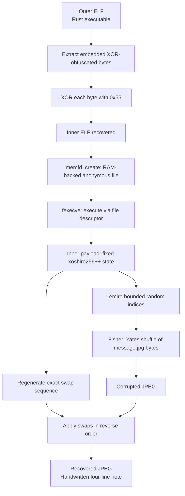

## Complete CTF Solution, Alternative Approaches & Reproducibility Guide

> **Category:** Reverse Engineering · Malware Analysis · Forensics · PRNG Reconstruction  
> **Challenge:** Cyber Command — Liber8tion ransomware scenario  
> **Result:** **Solved — 100/100 points** (per the supplied solver results)  
> **Analysis style:** Static analysis and offline Python reconstruction; **no execution of the unknown binaries**  
> **Prepared:** 6 November 2026

---

## Executive summary

The challenge provided a suspicious executable associated with a ransomware attack and a corrupted `message.jpg`. The objective was to identify the executable's programming language, classify its stealth technique in MITRE ATT&CK, identify the random-number generator family, and recover the message.

The reported solution showed a **two-stage Rust ELF loader**:

1. The **outer stage** XOR-decodes an embedded ELF with a repeating **16-byte key of `0x55`**.
2. It writes the decoded ELF to an anonymous RAM-backed file using `memfd_create` and executes it through `fexecve`, avoiding a conventional payload file on disk.
3. The **inner stage** corrupts the target file using a **Fisher–Yates byte shuffle**. Its swap indices are derived from a hard-coded **xoshiro256++** PRNG and Lemire-style multiply-high bounded sampling.
4. Because the initial state and file length are deterministic, the same swaps can be generated and **applied in reverse order** to restore the original JPEG.
5. The reported validation re-applied the shuffle to the recovered JPEG and matched the corrupted file **byte for byte**.

**Recovered message:**

```text
Hidden
Binary
Shuffles
Slow
```

> **Evidence boundary:** The findings and successful round-trip above were supplied in the solver's completion summary. This standalone report was not created by directly opening the Kali files. Exact hashes, function offsets, seed words, and captured command outputs are not available in the conversation and are therefore intentionally not invented. Add those details from the local artifacts before treating this document as a fully independent lab record.

---

## Table of contents

1. [Challenge questions and answers](#1-challenge-questions-and-answers)
2. [Attack chain at a glance](#2-attack-chain-at-a-glance)
3. [Safe analysis environment and evidence handling](#3-safe-analysis-environment-and-evidence-handling)
4. [Ways to solve the challenge](#4-ways-to-solve-the-challenge)
5. [Recommended step-by-step walkthrough](#5-recommended-step-by-step-walkthrough)
6. [Question-by-question technical explanation](#6-question-by-question-technical-explanation)
7. [Message recovery algorithm](#7-message-recovery-algorithm)
8. [Validation and quality checks](#8-validation-and-quality-checks)
9. [Troubleshooting and alternative hypotheses](#9-troubleshooting-and-alternative-hypotheses)
10. [Artifacts and reproduction checklist](#10-artifacts-and-reproduction-checklist)
11. [Lessons learned](#11-lessons-learned)
12. [References](#12-references)

---

## 1. Challenge questions and answers

| Question | Points | Final answer | Primary evidence |
|---|---:|---|---|
| **Q1. Programming language** | 5 | **Rust** | `rustc 1.100.0-nightly` artifacts; Rust runtime/compiler signatures; unstripped ELF with DWARF |
| **Q2. MITRE ATT&CK stealth technique** | 25 | **T1620 — Reflective Code Loading** | XOR-decoded ELF is placed in an anonymous `memfd_create` file and executed using `fexecve` |
| **Q3. RNG family** | 25 | **xoshiro / xoroshiro**, specifically **xoshiro256++** | Four 64-bit state words, characteristic rotate/XOR/shift sequence, `++` output scrambler |
| **Q4. Original message** | 45 | **Hidden / Binary / Shuffles / Slow** (four lines) | Recovered JPEG note; exact forward-shuffle round-trip |

**Submission caution:** Q2 asks for the **technique ID**, so submit `T1620` (without a decimal sub-technique suffix). For Q3, the family is *xoshiro / xoroshiro*; use the full implementation name *xoshiro256++* if the platform accepts a precise algorithm.

---

## 2. Attack chain at a glance



### Key distinction

The outer-stage XOR is **payload obfuscation**, not the transformation used to recover the image. The JPEG corruption is a **permutation of bytes**, not a bytewise XOR cipher. These two mechanisms must be analyzed separately.

---

## 3. Safe analysis environment and evidence handling

### Workspace

```text
~/Downloads/exploitation/                  # Original challenge folder
~/ctf-work/cyber-command/
├── evidence/                              # Read-only working copies
├── analysis/                              # Notes, extracted ELF, static-analysis outputs
├── scripts/
│   ├── extract_payload.py
│   └── recover_message.py
├── recovered/
│   └── message_recovered.jpg
└── report/
    ├── Cyber_Command_Writeup.md
    └── answers.txt
```

### Initial triage

Use the *actual* filenames from the directory; the commands below are intentionally discovery-oriented.

```bash
mkdir -p ~/ctf-work/cyber-command/{evidence,analysis,scripts,recovered,report}

find ~/Downloads/exploitation -maxdepth 3 -type f \
  -printf '%p\t%s bytes\n'

file ~/Downloads/exploitation/*
sha256sum ~/Downloads/exploitation/*

# Work only on copies of the challenge evidence.
cp -a ~/Downloads/exploitation/. ~/ctf-work/cyber-command/evidence/
find ~/ctf-work/cyber-command/evidence -type f -exec chmod a-w {} +
```

If files are archives or unusual formats, inspect them safely before extracting. Save the original SHA-256 values in the report.

### Safe execution policy

**Do not execute either unknown ELF directly on Kali**, and do not use `ldd` on an untrusted executable during initial triage, because some implementations or circumstances can result in code execution. Prefer `readelf`, `file`, `strings`, `objdump`, Ghidra, and offline Python.

If dynamic observation becomes indispensable, use a disposable, isolated VM with networking disabled, no host shares, no host credentials, and a clean snapshot. Dynamic analysis was **not required** in the reported successful solution.

---

## 4. Ways to solve the challenge

Several paths can reach the same answers. The most effective route for this case was **static analysis + Python reconstruction**.

| Approach | Main tools | Best for | Strengths | Limitations |
|---|---|---|---|---|
| **A. Static-first (recommended)** | `file`, `readelf`, `strings`, Ghidra, Python | Full solution without running malware | Safe, explainable, reproducible | Requires careful code tracing |
| **B. Ghidra-focused reverse engineering** | Ghidra decompiler, cross-references, function graphs | Complex control flow, Rust runtime noise | High-level logic and constant tracking | Rust binaries can be large and noisy |
| **C. Terminal-only reverse engineering** | `radare2`/`rizin`, `objdump`, `readelf`, `xxd`, Python | Minimal/headless Kali workflow | Scriptable, fast for targeted questions | Less friendly for complex decompilation |
| **D. Algorithm-first recovery** | Python, file-format checks, reconstructed PRNG | Once state and shuffle are identified | Efficient path to Q4 | Wrong bounds/seed/order produce garbage |
| **E. Isolated dynamic tracing (fallback)** | Disposable VM, debugger, syscall tracer | Only when static analysis cannot resolve a branch | Can confirm runtime behavior | Higher risk and setup cost; unnecessary here |

### Recommended choice

Use **A + B + D**:

1. Triage and identify Rust/ELF.
2. Locate embedded XOR-obfuscated payload bytes.
3. Recover the inner ELF offline.
4. Trace the inner stage in a decompiler.
5. Reimplement the PRNG and shuffle in Python.
6. Reverse the swaps and verify the original data.

### When to switch approaches

- **No meaningful symbols?** Use imports, strings, call graphs, instruction patterns, and Ghidra function signatures.
- **Outer stage too noisy?** Search for `memfd_create` and `fexecve`; trace backwards to the input buffer.
- **RNG unclear?** Search for `rotl 23`, `rotl 45`, `<< 17`, four-word state mutations, and multiply-high bounded sampling.
- **Recovered output invalid?** Re-check seed words, state endianness, index bounds, PRNG call counts, and swap-loop direction.
- **Static evidence insufficient?** Use an isolated VM only as a last resort.

---

## 5. Recommended step-by-step walkthrough

### Step 1 — Identify executable format, architecture, and language

```bash
BIN="/path/to/actual/outer_binary"   # Replace with the real copied filename
file "$BIN"
readelf -h "$BIN"
readelf -S "$BIN"
readelf -p .comment "$BIN" 2>/dev/null || true
readelf -Ws "$BIN" | head -80
strings -a -n 8 "$BIN" | grep -Ei \
  'rustc|rust_panic|core::|alloc::|std::|nightly|memfd|fexecve' | head -60
```

**What to look for:** Rust symbols and panic/runtime strings, compiler metadata, debug sections, and recognizable Rust demangling. A binary built with LLVM does *not* by itself prove Rust; use the language-specific evidence.

**Reported finding:** Rust, associated with `rustc 1.100.0-nightly`, unstripped and containing DWARF debug information.

**Checkpoint:** Identify at least two independent language indicators and note relevant symbol names or addresses from the local binary.

### Step 2 — Find the loader and embedded payload

Inspect imports and cross-references to `memfd_create`, `fexecve`, writes to file descriptors, and XOR loops.

```bash
readelf -Ws "$BIN" | grep -E 'memfd_create|fexecve|execve|write'
objdump -d -C "$BIN" > ~/ctf-work/cyber-command/analysis/outer_disassembly.txt
```

In Ghidra:

1. Import the ELF **without executing it**.
2. Run standard auto-analysis.
3. Find references to `memfd_create` and `fexecve`.
4. Trace the buffer populated before the anonymous file is written.
5. Identify the XOR transform and its source data.
6. Determine the exact offset and length of the embedded blob.

**Reported finding:** The embedded ELF is protected by a repeating 16-byte key consisting entirely of `0x55`. Decoding yields an ELF.

For a known extracted blob, the decoder is mathematically simple:

```python
decoded = bytes(b ^ 0x55 for b in embedded_blob)
assert decoded.startswith(b"\x7fELF")
```

The important challenge is finding the **correct blob boundaries**. Do not blindly XOR the whole outer executable and assume the result is valid.

**Checkpoint:** Record the embedded blob offset, size, extraction method, and SHA-256 of the decoded inner ELF.

### Step 3 — Classify the stealth behavior (Q2)

The outer loader follows this logical sequence:

```text
embedded bytes
    |
    v
XOR decode
    |
    v
memfd_create() -> anonymous in-memory file descriptor
    |
    v
write decoded ELF bytes
    |
    v
fexecve(fd, argv, envp)
```

This maps to **MITRE ATT&CK T1620 — Reflective Code Loading**. MITRE explicitly discusses executing payloads via anonymous files existing only in RAM. `fexecve` takes a file descriptor rather than a conventional executable pathname. This is consistent with a fileless, memory-backed staging design.

**Nuance:** This is not proof of *cross-process code injection*; the observed behavior is an in-memory executable loader. Avoid labeling it as process injection without separate evidence.

**Checkpoint:** Cite the call sites to both APIs, the decoded ELF buffer, and the ATT&CK technique description.

### Step 4 — Reverse engineer the inner ELF

Open the **decoded inner ELF** as a separate analysis target.

Focus on:

- Where `message.jpg` (or the target path) is opened and read;
- whether bytes are rewritten or rearranged;
- the loop range and direction;
- the size/type of the RNG state;
- constants and bit operations;
- random-to-index conversion;
- any conditions that consume extra random draws.

**Reported finding:** The corruption was a Fisher–Yates shuffle over the **entire file's bytes**, with indices derived from xoshiro256++ and a Lemire multiply-high bounded sampler.

**Checkpoint:** Establish the actual loop order and bounds from code before translating them into Python.

### Step 5 — Recognize xoshiro256++ (Q3)

The generator has four 64-bit state words:

\[
s = (s_0, s_1, s_2, s_3)
\]

Its characteristic output transformation is:

\[
r = \operatorname{rotl}_{64}(s_0+s_3,23)+s_0 \pmod{2^{64}}
\]

The state update includes a temporary word `s1 << 17`, a sequence of XORs, and a `rotl(..., 45)` rotation. Those elements together strongly distinguish **xoshiro256++** from generic xorshift or a linear congruential generator.

The solver reported four **hard-coded seed words**. Their exact hexadecimal values were not included in the supplied summary; copy them from the local disassembly or the completed recovery script.

**Checkpoint:** Compare state-transition instructions with the canonical reference implementation and verify a sequence of PRNG outputs against the reconstructed logic.

### Step 6 — Reconstruct the bounded index generator

The shuffle does not use the raw 64-bit PRNG output as an index. It uses a **bounded sampling** step consistent with Lemire multiply-high mapping. A typical 64-bit version for `bound > 0` is:

```python
MASK64 = (1 << 64) - 1

def bounded_u64(next_u64, bound: int) -> int:
    assert 1 <= bound <= (1 << 64)
    threshold = ((1 << 64) - bound) % bound
    while True:
        x = next_u64()
        product = x * bound
        low = product & MASK64
        if low >= threshold:
            return product >> 64
```

**Important:** This is a **reference pattern**, not a substitute for validating the exact inner-binary implementation. A rejection consumes another random output, so even a single missed rejection can shift every subsequent swap. Bound choice (`i`, `i+1`, or another expression) and loop direction must come from the actual code.

The supplied solver summary says the rejection path existed but was not taken in the verified run. That follows from the exact round-trip; it should not be treated as an unconditional guarantee for other inputs.

### Step 7 — Undo the Fisher–Yates shuffle

Generate the same ordered list of swaps used during the corruption. If the original sequence is:

\[
S_1, S_2, \ldots, S_k
\]

then recovery must apply:

\[
S_k, S_{k-1}, \ldots, S_1
\]

Each individual swap is its own inverse; the **sequence order** is what changes.

Pseudocode:

```python
corrupted = bytearray(open("message.jpg", "rb").read())

# Regenerate swaps from the exact seed, PRNG, bounded-index
# calculation, and loop sequence discovered in the inner ELF.
swaps = reproduce_original_swaps(len(corrupted))

for i, j in reversed(swaps):
    corrupted[i], corrupted[j] = corrupted[j], corrupted[i]

open("message_recovered.jpg", "wb").write(corrupted)
```

`reproduce_original_swaps` above is intentionally a **conceptual placeholder**; the actual ready-to-run recovery implementation is already located at `~/ctf-work/cyber-command/scripts/recover_message.py`.

**Checkpoint:** The recovered bytes should pass format checks as a JPEG and display the note. An image that merely opens is not enough—complete the round-trip test.

### Step 8 — Read and submit the message (Q4)

The restored image was reported as a **1536 × 2048 baseline JPEG**, beginning with `FF D8 FF E0` and ending with `FF D9`, containing a handwritten note:

```text
Hidden
Binary
Shuffles
Slow
```

The initials **H-B-S-S** provide a mnemonic for the challenge's chain:

| Word | Meaning in this solution |
|---|---|
| **Hidden** | Diskless / anonymous memory-backed loading |
| **Binary** | Nested ELF executable |
| **Shuffles** | Deterministic Fisher–Yates byte permutation |
| **Slow** | Byte-at-a-time I/O behavior reported by the solver |

The interpretation of the initials is secondary; the image itself is the evidence for the exact message.

---

## 6. Question-by-question technical explanation

### Q1 — Why Rust?

The executable retained language-specific evidence: a Rust toolchain signature (`rustc 1.100.0-nightly`), symbols/runtime identifiers, and DWARF debug information. These are more discriminating than simply observing that an ELF uses LLVM tooling.

**Answer:** `Rust`

### Q2 — Why T1620?

The outer stage reconstructs an executable in memory and uses an anonymous file descriptor for execution (`memfd_create` → `fexecve`). The stealth objective is to avoid a normal on-disk executable payload artifact. MITRE's **T1620 Reflective Code Loading** covers this general pattern, including anonymous RAM-backed payloads.

**Answer:** `T1620`

**Official reference:** <https://attack.mitre.org/techniques/T1620/>

### Q3 — Why xoshiro256++?

The implementation uses four 64-bit state words and the distinctive `++` output scrambler with rotate by 23, followed by the XOR/shift state transition and rotate by 45. The multiplication used for bounded indexing is a **separate range-reduction step**, not proof that the PRNG itself belongs to a multiplicative generator family.

**Answer:** `xoshiro / xoroshiro` (*xoshiro256++*)

**Reference source code:** <https://prng.di.unimi.it/xoshiro256plusplus.c>

### Q4 — Why is the recovered message correct?

The restored file is structurally a JPEG and visibly contains the note, but the decisive test is **round-trip consistency**:

1. Start from recovered bytes.
2. Reinitialize the generator to the recovered fixed state.
3. Apply the **original forward Fisher–Yates swaps**.
4. Compare every output byte with the supplied corrupted `message.jpg`.

The user-provided solver summary reports an exact match. That is strong evidence that the reconstruction accounts for the byte permutation, state advancement, and index-generation logic.

**Answer (preserve line breaks):**

```text
Hidden
Binary
Shuffles
Slow
```

---

## 7. Message recovery algorithm

### Why a shuffle is reversible

A Fisher–Yates shuffle is a **permutation**, meaning it rearranges existing bytes instead of replacing their values. A permutation has an inverse. If the index sequence can be reconstructed, the inverse can be applied exactly.

For a common descending-loop form:

```python
# Illustrative forward shuffle; confirm the actual loop in disassembly.
for i in range(len(data) - 1, 0, -1):
    j = bounded_random(i + 1)
    data[i], data[j] = data[j], data[i]
```

When reconstructing the swaps, store each pair `(i, j)` in generation order, and replay them **backwards** to recover the original. Another workable implementation stores the generated indices and replays them with an ascending inverse pass; equivalence depends on matching the original loop.

### xoshiro256++ reference logic

This compact Python code illustrates the canonical generator's step. **It is not the challenge's complete drop-in recovery script** because the four actual seed values and file-specific loop details were not provided in the summary.

```python
MASK64 = (1 << 64) - 1

def rotl64(x, k):
    x &= MASK64
    return ((x << k) | (x >> (64 - k))) & MASK64

class Xoshiro256PP:
    def __init__(self, seed_words):
        assert len(seed_words) == 4
        self.s = [x & MASK64 for x in seed_words]
        assert any(self.s), "The all-zero state is invalid."

    def next_u64(self):
        s0, s1, s2, s3 = self.s
        out = (rotl64((s0 + s3) & MASK64, 23) + s0) & MASK64
        t = (s1 << 17) & MASK64

        s2 ^= s0
        s3 ^= s1
        s1 ^= s2
        s0 ^= s3
        s2 ^= t
        s3 = rotl64(s3, 45)

        self.s = [s0 & MASK64, s1 & MASK64, s2 & MASK64, s3]
        return out
```

### Critical implementation details

- **Seed words:** Use all four exact 64-bit constants from the payload, not a guessed integer seed.
- **Overflow:** All PRNG arithmetic is modulo \(2^{64}\).
- **Rotation:** A rotate is not the same as a logical shift.
- **Range reduction:** Multiply-high and modulo are **not interchangeable**.
- **Rejection:** Preserve any additional draws taken by the bounded sampler.
- **Swap order:** Reversing the **indices' order** is essential.
- **Whole-file behavior:** The reported shuffle covers all file bytes; do not skip the JPEG header unless code proves it.
- **Input length:** A different-length file changes shuffle bounds and thus the swap sequence.
- **Output validation:** Use exact binary comparison, not just file type or visual inspection.

---

## 8. Validation and quality checks

### Level 1 — File signature and metadata

```bash
REC=~/ctf-work/cyber-command/recovered/message_recovered.jpg
file "$REC"
xxd -l 16 "$REC"
tail -c 16 "$REC" | xxd
sha256sum "$REC"

# Optional if ImageMagick is installed:
identify "$REC"
```

**Reported expected observations:** JPEG beginning `FF D8 FF E0`, ending `FF D9`, dimensions **1536 × 2048**. A strict JPEG decoder should open it cleanly.

### Level 2 — Byte-count and round-trip

The reported solution re-shuffled the recovered image and generated a byte-identical match to the corrupted input. To reproduce this, use the **existing completed recovery script's interface**; inspect it first:

```bash
python3 ~/ctf-work/cyber-command/scripts/recover_message.py --help
```

Run its documented *forward verification / round-trip* function or command to produce a temporary corruption output, then compare:

```bash
# Set these to the original corrupted file and the script-generated re-shuffle.
ORIGINAL_CORRUPTED="/path/to/original/message.jpg"
RESHUFFLED="/path/to/generated/reshuffled_message.jpg"

cmp -s "$ORIGINAL_CORRUPTED" "$RESHUFFLED" \
  && echo "PASS: exact byte-for-byte round-trip" \
  || echo "FAIL: outputs differ"

sha256sum "$ORIGINAL_CORRUPTED" "$RESHUFFLED"
```

> Do not assume the existing script accepts a specific flag name; its full CLI usage was not supplied. **Use its actual `--help` output or inspect its source.** The `cmp` command only verifies a match if `$RESHUFFLED` really was produced by the forward re-shuffle.

### Level 3 — Evidence and answer consistency

| Check | Expected pass condition | Reported status |
|---|---|---|
| Language evidence | Rust-specific signatures and toolchain metadata | **Pass** |
| Stealth classification | Anonymous memory-backed ELF and execution via file descriptor | **Pass** |
| RNG identification | Canonical xoshiro256++ step and four-word state | **Pass** |
| JPEG recognition | Valid start/end markers and decodable image | **Pass** |
| Message extraction | Four legible handwritten lines | **Pass** |
| Round-trip | Exact equality to corrupted file | **Pass** |

The status column reflects the **supplied solver report**, not fresh execution performed for this document.

### Evidence fields to populate from Kali

| Evidence item | Actual value to record |
|---|---|
| Original outer ELF SHA-256 | `[INSERT FROM sha256sum]` |
| Original corrupted JPEG SHA-256 | `[INSERT FROM sha256sum]` |
| Decoded inner ELF SHA-256 | `[INSERT FROM sha256sum]` |
| Recovered JPEG SHA-256 | `[INSERT FROM sha256sum]` |
| Outer payload offset and length | `[INSERT FROM EXTRACTOR / GHIDRA]` |
| Four xoshiro256++ seed words | `[INSERT 4 × 64-BIT HEX CONSTANTS]` |
| Important Ghidra function addresses | `[INSERT ADDRESSES]` |
| Successful `cmp`/round-trip command output | `[PASTE CAPTURED OUTPUT]` |

This table deliberately separates observed facts from locally reproducible metadata that was **not provided**.

---

## 9. Troubleshooting and alternative hypotheses

| Symptom | Likely issue | Diagnostic / correction |
|---|---|---|
| Decoded payload does not begin `7F 45 4C 46` | Wrong embedded range or XOR alignment | Trace data references and exact length; check key alignment |
| Static scan finds only Rust runtime noise | Large unstripped Rust executable | Search `memfd_create`/`fexecve` call sites, then track caller data flow |
| Extracted inner ELF appears invalid | Incomplete copy, alignment, or multiple encoded sections | Validate `readelf -h`, section bounds, and buffer length |
| PRNG outputs mismatch | Wrong state word order or unchecked integer width | Use 64-bit masks; verify update sequence and `++` scrambler |
| Partially readable JPEG | Incorrect shuffle bounds or off-by-one | Check `range(n-1, 0, -1)` vs actual loop |
| No recognizable JPEG magic | Reversed swaps in incorrect order | Record forward swap sequence, then iterate `reversed(swaps)` |
| Occasional mismatch after many swaps | Lemire rejection not modeled | Include the low-product threshold/retry logic |
| Round-trip fails though image opens | Incomplete or approximate reconstruction | Compare hashes and first differing byte; trace every PRNG call |
| Confusion between RNG and bounding | Multiply-high mistaken for generator | Separate xoshiro state transition from the index mapper |

### Other plausible hypotheses to rule out early

1. **Simple XOR corruption:** would change byte values rather than only positions.
2. **Standard encryption:** generally has keys, blocks, or streaming byte transforms; here the decisive behavior is a permutation.
3. **Mersenne Twister / LCG / xorshift:** state shape and transition constants do not match the reported xoshiro256++ step.
4. **Process injection:** the reported chain does not establish writing into another process.
5. **Payload dropped to disk:** `memfd_create`/`fexecve` supports a RAM-backed execution path instead.

---

## 10. Artifacts and reproduction checklist

### Reported project files

| Artifact | Kali location | Purpose |
|---|---|---|
| Payload extractor | `~/ctf-work/cyber-command/scripts/extract_payload.py` | Decode outer-stage embedded ELF |
| Recovery/verification script | `~/ctf-work/cyber-command/scripts/recover_message.py` | Rebuild PRNG/shuffle, recover message, verify round-trip |
| Recovered JPEG | `~/ctf-work/cyber-command/recovered/message_recovered.jpg` | Original handwritten note |
| Original solver write-up | `~/ctf-work/cyber-command/report/Cyber_Command_Writeup.md` | Primary technical evidence |
| Answers | `~/ctf-work/cyber-command/report/answers.txt` | Submission-ready responses |

These paths are **reported** from the Kali run and have not been accessed from the environment used to author this guide.

### Reproduction checklist

- [ ] Hash and preserve original artifacts.
- [ ] Verify the outer ELF architecture and Rust build indicators.
- [ ] Locate the XOR-encoded payload and record source offset/length.
- [ ] Decode the inner ELF and verify its `0x7fELF` header.
- [ ] Find `memfd_create` and `fexecve` call chain.
- [ ] Map this behavior to ATT&CK `T1620`.
- [ ] Locate the byte-shuffle routine and identify its exact bounds.
- [ ] Recover all four xoshiro256++ seed words.
- [ ] Cross-check PRNG output/state changes against reference code.
- [ ] Reproduce the bounded random index values.
- [ ] Generate and invert the original swap sequence.
- [ ] Verify JPEG headers, dimensions, and visual content.
- [ ] Re-apply forward swaps and obtain `cmp` equality.
- [ ] Store commands, hashes, function addresses, script versions, and outputs.
- [ ] Submit the exact four answers.

### Concise final answer block

```text
Q1: Rust
Q2: T1620
Q3: xoshiro / xoroshiro (xoshiro256++)
Q4:
Hidden
Binary
Shuffles
Slow
```

---

## 11. Lessons learned

### 1. Never trust the first executable layer

A binary may contain another executable disguised as data. Follow data flow from decoding operations to system calls; do not assume the outer program contains the actual file-corruption algorithm.

### 2. Separate staging from payload behavior

The XOR operation concealed the nested ELF. The actual file corruption was a reversible **shuffle**. Correctly separating these roles made the problem much easier.

### 3. Familiar constants reveal algorithms

The `rotl(...,23)`, `<<17`, and `rotl(...,45)` pattern—together with four 64-bit words and a `++` output scrambler—is a strong algorithm fingerprint.

### 4. “Random-looking” does not mean unrecoverable

A PRNG with known fixed initial state is deterministic. Once its outputs and bounded-index mapping are reproduced, the Fisher–Yates permutation is exactly reversible.

### 5. Binary verification beats plausibility

A JPEG that opens and contains plausible text is good evidence. Reapplying the corruption algorithm and reproducing the original bytes **exactly** is much stronger.

### 6. Reports should distinguish observed data from inference

Preserve command outputs, offsets, hashes, and test artifacts. When details are missing, mark them as missing instead of inventing them.

---

## 12. References

1. **MITRE ATT&CK — T1620: Reflective Code Loading**  
   <https://attack.mitre.org/techniques/T1620/>

2. **MITRE ATT&CK — DET0300: Detection Strategy for Reflective Code Loading**  
   <https://attack.mitre.org/detectionstrategies/DET0300/>

3. **Linux manual — `memfd_create(2)`**  
   <https://man7.org/linux/man-pages/man2/memfd_create.2.html>

4. **Linux manual — `fexecve(3)`**  
   <https://man7.org/linux/man-pages/man3/fexecve.3.html>

5. **Blackman and Vigna — canonical xoshiro256++ reference implementation**  
   <https://prng.di.unimi.it/xoshiro256plusplus.c>

6. **Vigna — PRNG shootout and xoshiro/xoroshiro family overview**  
   <https://prng.di.unimi.it/>

7. **Blackman & Vigna — Scrambled Linear Pseudorandom Number Generators**  
   <https://vigna.di.unimi.it/ftp/papers/ScrambledLinear.pdf>

---

### Final conclusion

**Cyber Command was solved through static reverse engineering and deterministic data recovery.** The outer Rust loader concealed an inner ELF and executed it from an anonymous memory-backed file. The inner stage shuffled file bytes using xoshiro256++-derived indices. With the initial state and transformation known, reversing the recorded permutation recovered a JPEG containing the four-line message:

> **Hidden**  
> **Binary**  
> **Shuffles**  
> **Slow**

The supplied solver results report a **byte-for-byte round-trip**, establishing the reconstruction's correctness for the provided challenge artifact.
